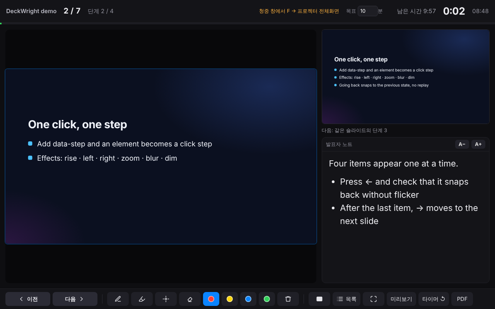

# DeckWright

[English](README.md) · 한국어

**AI가 만든 HTML 발표 자료를 PowerPoint처럼 발표합니다.**

AI가 만든 HTML 슬라이드는 이미 PPT보다 표현력이 좋지만, 브라우저 탭으로 발표하면 발표자 노트도, 다음 슬라이드 미리보기도, 펜도 없고 클리커도 반쯤만 먹힙니다. DeckWright는 그 빈자리를 HTML 파일 안에 들어가는 작은 런타임(약 85KB, 의존성 없음)으로 채웁니다. 설치할 것이 없고, 인터넷이 없어도 되고, 파일을 더블클릭하면 바로 발표 모드로 열립니다.



**바로 써 보기:** [데모 덱](https://grotyx.github.io/deckwright/demo.html) (`S`, `?`를 눌러 보세요) · [플레이어](https://grotyx.github.io/deckwright/player.html) · [규약](SPEC.ko.md)

## 무엇이 되나

- 클릭, 휠, 방향키, 클리커(PageUp/PageDown, F5, 검은 화면 버튼)로 앞뒤 이동. 슬라이드 안의 클릭 단계 애니메이션까지. 뒤로 가면 애니메이션 없이 직전 상태로 즉시
- **발표자 창**(노트북)과 청중 화면(프로젝터) 분리: 현재 화면, 다음 화면(다음 단계까지), 발표자 노트, 경과 시간, 목표 대비 남은 시간, 슬라이드 목록
- 펜, 형광펜, 레이저, 지우개. 펜 태블릿은 도구를 켜지 않아도 바로 필기. 어느 쪽 화면에서 그려도 양쪽에 보이고 새로고침해도 유지
- 검은 화면/흰 화면, 보조 모니터 전체화면(브라우저가 지원하면 자동)
- `Ctrl/⌘+P`로 모든 단계가 펼쳐진 PDF (슬라이드당 한 쪽)
- DeckWright를 모르고 만든 덱도 자동 인식. 자체 이동 엔진이 있는 덱은 그 엔진을 그대로 조종하고(애니메이션 보존), 인쇄용으로 고정 크기 슬라이드를 쌓아 둔 덱은 현재 슬라이드를 화면에 맞춰 확대, reveal.js 덱도 인식
- 화면 문구는 브라우저 언어에 따라 한국어/영어

## 두 가지 파일 형태

**단독 HTML** — 런타임과 그림·폰트·영상을 모두 넣은 `.html` 한 개. 메일로 보내거나 USB에 담아 더블클릭.

**`.hdek` 패키지** — 영상이 크거나 파일이 많을 때 쓰는 ZIP 컨테이너(`manifest.json` + `index.html` + 자원). `player.html`로 열거나, 확장자를 `.zip`으로 바꿔 풀고 `index.html`을 더블클릭.

## 설치

DeckWright는 에이전트 스킬(`skills/deckwright/` 폴더)이고 그 안에 Node 명령줄 도구가 들어 있습니다. 쓰는 환경에 맞는 방법을 고르세요.

### Claude Code (플러그인 마켓플레이스)

```bash
claude plugin marketplace add grotyx/deckwright
claude plugin install deckwright@deckwright
```

Claude Code 안에서는 `/plugin marketplace add grotyx/deckwright` 다음 `/plugin install deckwright@deckwright`. 업데이트는 `claude plugin marketplace update deckwright && claude plugin update deckwright@deckwright`.

### 스킬을 읽는 다른 에이전트(Claude Code, Codex, Cursor 등) — `npx skills`

```bash
npx skills add grotyx/deckwright          # 현재 프로젝트에
npx skills add grotyx/deckwright -g       # 사용자 전체에
```

### 직접 복사

```bash
git clone https://github.com/grotyx/deckwright
cp -r deckwright/skills/deckwright ~/.claude/skills/
```

### claude.ai (웹 / 데스크톱 앱)

[deckwright-skill.zip](https://grotyx.github.io/deckwright/deckwright-skill.zip)을 받아 **설정 → 기능(Capabilities) → 스킬**에서 업로드합니다. 코드 실행이 켜져 있어야 합니다.

### 플레이어만 (AI도 설치도 없이)

[player.html](https://grotyx.github.io/deckwright/player.html)을 받거나 온라인에서 바로 열고, `.hdek`·`.html`·덱 폴더를 끌어다 놓은 뒤 "발표 시작".

### 명령줄 도구만 (Node.js 18 이상)

```bash
npm install -g github:grotyx/deckwright
deckwright --help
```

## 사용

### AI에게 맡기기

스킬을 설치한 뒤 이렇게 요청하면 됩니다.

- "이 HTML 덱 발표할 수 있게 해 줘" → 원본 옆에 런타임을 넣은 사본(`발표_DeckWright.html`)을 만듭니다. 원본은 건드리지 않습니다.
- "OO 주제로 15분 학회 발표를 DeckWright 덱으로 만들어 줘" → 규약에 맞춰 덱을 만들고 점검한 뒤 단독 HTML로 빌드합니다.
- ".hdek으로 묶어 줘" / "PDF·PPTX 백업도 만들어 줘"

스킬을 지원하지 않는 AI에게는 [`skills/deckwright/SKILL.md`](skills/deckwright/SKILL.md) 내용을 지시문으로 주면 됩니다.

### 발표하기

파일을 엽니다. `S`로 발표자 창을 열고, 청중 창을 프로젝터 쪽으로 옮긴 뒤 그 창에서 `F`를 누르면 전체화면입니다. `?`를 누르면 전체 단축키가 나옵니다.

| 동작 | 키 |
|---|---|
| 다음 / 이전 | `→` `Space` `PageDown` 클릭 휠 / `←` `PageUp` |
| n번 슬라이드로 | 숫자 `n` 입력 후 `Enter` |
| 발표자 창 | `S` |
| 전체화면 | `F` (클리커의 `F5`) |
| 검은 / 흰 화면 | `B` / `W` |
| 펜 / 형광펜 / 레이저 / 지우개 | `D` / `H` / `L` / `E`, `C` 지우기 |
| PDF 인쇄 | `Ctrl/⌘+P` |

### 명령줄 도구

```bash
deckwright check  my-talk/                     # 규약·외부 CDN·폰트·노트 점검
deckwright inject my-talk/index.html           # 원본 옆에 index_DeckWright.html (그림·영상은 원래 폴더 참조, 가장 가벼움)
deckwright build  my-talk/ -o my-talk.html     # 단독 HTML
deckwright pack   my-talk/ -o my-talk.hdek     # 패키지
deckwright unpack my-talk.hdek -o my-talk/
deckwright export my-talk/ --pdf a.pdf --pptx a.pptx --png shots/
```

전역 설치 없이 쓰려면 저장소(또는 스킬이 설치된 폴더)에서 `node skills/deckwright/scripts/deckwright.mjs …`. `export`는 Playwright와 pptxgenjs가 필요합니다(`npm i -g playwright pptxgenjs && npx playwright install chromium`). 학회가 PPTX·PDF만 받을 때를 위한 백업으로, 각 슬라이드의 최종 화면을 이미지로 넣고 발표자 노트는 PPTX 노트로 옮깁니다. 명령줄 메시지도 시스템 언어에 따라 한국어/영어로 나옵니다(`DECKWRIGHT_LANG=ko`로 고정 가능).

## 규약 한 화면 요약

```html
<main data-hdek data-width="1920" data-height="1080" data-duration="7">
  <section data-slide="results">
    <h2>결과</h2>
    <p data-step data-effect="rise">클릭하면 나타남</p>
    <aside class="notes">발표자 노트</aside>
  </section>
</main>
<script src="deckwright-runtime.js" data-hdek-runtime></script>
```

단계 효과, 숫자·차트용 JS 훅, 이벤트, `.hdek` 형식, 규약 없는 덱을 인식하는 방식은 [SPEC.ko.md](SPEC.ko.md)에 있습니다.

## 폴더 구조

```
skills/deckwright/              스킬 (설치되는 부분)
  SKILL.md                      AI용 지시문
  runtime/deckwright-runtime.js 덱 안에 들어가는 런타임
  core/deckwright-core.js       자원 인라인, ZIP, 점검 (브라우저·Node 공용)
  scripts/deckwright.mjs        명령줄 도구
  assets/template.html          새 덱 템플릿
  player.html                   빌드된 플레이어
  reference/SPEC.md             규약 사본
player/player.src.html          플레이어 원본
docs/                           GitHub Pages: 데모, 플레이어, 스킬 zip
examples/                       규약 데모 덱, 규약 없이 만든 AI풍 덱
test/                           Playwright 테스트와 픽스처
.claude-plugin/                 Claude Code 플러그인·마켓플레이스 매니페스트
```

`npm run build`로 플레이어·데모·스킬 zip을 다시 만들고, `npm test`로 Chromium에서 61개 항목을 확인합니다(`pip install playwright pdfplumber python-pptx` 필요). Firefox와 WebKit에서도 이동, 발표자 창, 플레이어를 확인했습니다.

## 확인된 한계

- 보조 모니터 자동 배치(`F`)는 Chrome/Edge의 Window Management API를 쓰며 처음에 권한을 묻습니다. 실제 듀얼 모니터에서는 아직 시험하지 않았습니다. 안 되면 청중 창을 끌어다 놓고 `F`.
- 발표자 창 미리보기는 같은 덱을 두 번 더 띄우므로 아주 무거운 덱에서는 느려질 수 있습니다. "미리보기" 버튼으로 현재 화면 미리보기를 끌 수 있습니다.
- 영상 재생 위치는 청중 창과 미리보기 사이에 동기화하지 않습니다(미리보기 영상은 음소거).
- 덱이 `setTimeout`으로 직접 만든 애니메이션은 뒤로 갈 때 즉시 끝낼 수 없습니다. 규약의 `setStep` 훅을 쓰세요.
- 휴리스틱 모드에서는 덱 자체의 진행 막대 같은 장식이 갱신되지 않을 수 있습니다.
- 많은 학회가 PPTX/PDF만 받아 중앙 PC에서 틉니다. 본인 노트북을 연결할 수 없는 자리에서는 `export` 백업을 쓰세요.

## 다음 단계 후보

- 데스크톱 앱(Tauri): `.hdek` 더블클릭 연결, 듀얼 모니터 자동 배치, 클리커 키 설정
- 휴대폰 리모컨(같은 Wi-Fi, QR 코드)
- 필기를 포함한 PDF 내보내기, 영상이 들어간 PPTX
- `.hdek` 서명과 무결성 검증

## 라이선스

[MIT](LICENSE) © 2026 Sang-Min Park. Lectern, DeckStage(MIT)의 공개된 아이디어를 참고했고 코드는 새로 작성했습니다.

*Wright* 시리즈: RefWright, ManuWright, RadWright, DeckWright.
