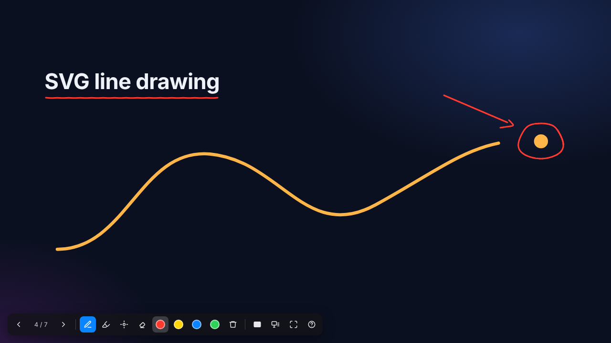
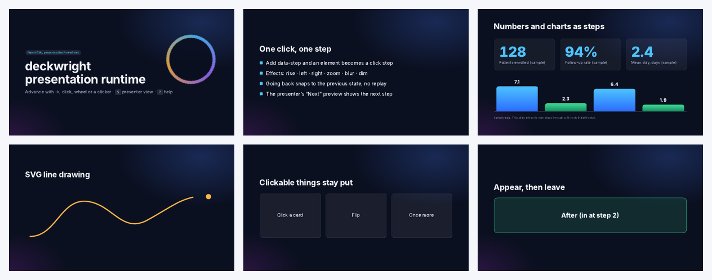
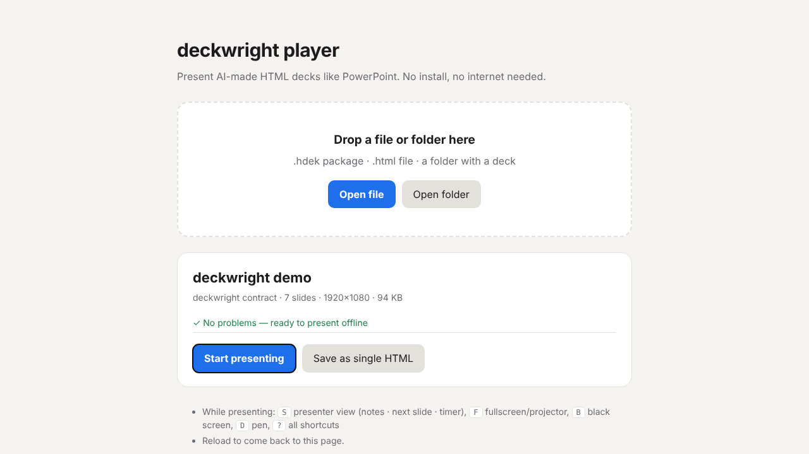

<p align="center">
  <picture>
    <source media="(prefers-color-scheme: dark)" srcset="assets/logo-dark.png">
    
  </picture>
</p>

<h1 align="center">deckwright</h1>

<p align="center">
  <em>Your slides on their screen. Your notes on yours.</em>
</p>

<p align="center">
  <a href="https://github.com/grotyx/deckwright/actions/workflows/tests.yml"></a>
  
  
  
  
</p>

<p align="center">
  <strong>Click steps &middot; presenter view &middot; pen &middot; print to PDF &middot; one HTML file, no install, no internet</strong><br>
  <sub>Present the HTML decks your AI makes the way you present PowerPoint. Works with Claude Code, Codex, Cursor and claude.ai as a skill.</sub>
</p>

<p align="center">
  <sub><a href="https://grotyx.github.io/deckwright/demo.html">Live demo</a> &middot; <a href="docs/manual.md">User guide</a> &middot; <a href="SPEC.md">Spec</a> &middot; <a href="CHANGELOG.md">Changelog</a> &middot; <a href="README.ko.md">한국어</a></sub>
</p>

---

You know him. The AV tech in the back of every well-run conference hall. Before your session he puts your notes on the podium laptop and only your slides on the big screen. The clicker works the first time. When you step back a slide, nobody watches the animation replay. When you circle something on the screen, the whole room sees it.

AI now writes slides in HTML that look better than most PowerPoint files. Open one at the podium, though, and he is gone: a browser tab, no notes, no next slide, a clicker that scrolls the page.

deckwright puts him inside the HTML file.

<table>
  <tr>
    <td width="50%" align="center"><br><b>Presenter view on your laptop</b></td>
    <td width="50%" align="center"><br><b>Pen, highlighter and laser</b></td>
  </tr>
  <tr>
    <td width="50%" align="center"><br><b>Ctrl+P: one page per slide, every step revealed</b></td>
    <td width="50%" align="center"><br><b>Player for .hdek packages and folders</b></td>
  </tr>
</table>

## Before / after

You have `talk.html`, made by an AI. Without deckwright you double-click it and present from a browser tab. Your notes are on paper. PageDown scrolls the page instead of advancing. Going back replays every animation from the start.

With deckwright:

```text
$ deckwright inject talk.html
✓ talk_deckwright.html (double-click it next to the original)
```

Double-click the new file, press `S`, drag the audience window to the projector and press `F` there. Your laptop shows the current slide, the next step, your notes and the clock. The projector shows only the slides. The original `talk.html` is not touched.

## How it works

```text
 talk.html  +  runtime (inline, ~85 KB, no network)
      │
      ├─▶ audience window       slides only, on the projector
      └─▶ presenter window      current · next · notes · timer · pen, on your laptop

 how the runtime reads the deck
      ├─ deckwright contract    exact steps and notes (data-slide, data-step)
      ├─ its own nav engine     steered by keys, the deck's animations kept
      └─ fixed-size slides,     one at a time, fitted to the screen
         reveal.js
```

| Promise | How |
|---|---|
| Going back never replays an animation | Every screen is `(slide, step)`; back snaps to the final look of that step |
| The presenter's previews look exactly like the projector | The previews load the same deck again in preview mode, CSS, JS and video included |
| The clicker works | Arrow keys, PageUp/PageDown, F5, the blank-screen key, mouse wheel and click |
| Nothing breaks without Wi-Fi | `build` inlines every asset; `check` warns about CDNs and web fonts |
| Ink stays where you put it | Saved per slide, shown on both screens, kept through a reload |
| The handout has every step | `Ctrl/⌘+P` prints the final state of each slide, one per page |
| Your original is safe | `inject` and `build` write a new file next to it |

## Install

Four ways, one skill. Pick one.

**A. Claude Code plugin.**

```sh
claude plugin marketplace add grotyx/deckwright
claude plugin install deckwright@deckwright
```

Update with `claude plugin marketplace update deckwright && claude plugin update deckwright@deckwright`.

**B. Any agent that reads skills** (Claude Code, Codex, Cursor, opencode and others).

```sh
npx skills add grotyx/deckwright        # this project
npx skills add grotyx/deckwright -g     # every project
```

**C. claude.ai.** Download [deckwright-skill.zip](https://grotyx.github.io/deckwright/deckwright-skill.zip) and upload it in Settings → Capabilities → Skills (code execution on).

**D. No AI at all.** Open [player.html](https://grotyx.github.io/deckwright/player.html), drop a deck on it, press *Start presenting*. For the command line: `npm install -g github:grotyx/deckwright`.

## Use it from the chat

| Say | What happens |
|---|---|
| "make this HTML deck presentable" | A copy with the runtime, `talk_deckwright.html`, next to the original |
| "make a 15-minute talk on X as a deckwright deck" | A new deck that follows the contract: click steps, notes on every slide, a time target, checked and built into one file |
| "make it one file I can email" | Every image, font and video inlined into a single `.html` |
| "package it as .hdek" | A ZIP package for decks with large videos, opened with the player |
| "export a PDF and PPTX backup" | For conferences that only take PPTX or PDF: each slide's final look, notes in the PPTX notes |
| "check my deck before the talk" | External CDNs, web fonts, missing files, slides without notes |

## Presenting

| Action | Keys |
|---|---|
| Next / previous | `→` `Space` `PageDown` click wheel / `←` `PageUp` |
| Jump to slide *n* | type *n*, then `Enter` |
| Presenter view | `S` |
| Fullscreen on the projector | `F` (or a clicker's `F5`) |
| Black / white screen | `B` / `W` |
| Pen, highlighter, laser, eraser | `D` `H` `L` `E`; a pen tablet writes right away; `C` clears |
| Print to PDF | `Ctrl/⌘+P` |
| All shortcuts | `?` |

The interface follows the browser language (English or Korean).

## Commands

| Command | What it does |
|---|---|
| `deckwright inject <file.html>` | Adds the runtime to a copy next to the original; images and video still load from the original folder |
| `deckwright build <input> -o talk.html` | One self-contained HTML with the runtime and every asset |
| `deckwright pack <input> -o talk.hdek` | `.hdek` package (ZIP) for large videos or many files |
| `deckwright unpack <talk.hdek> -o dir` | Extract a package |
| `deckwright check <input>` | Slides, steps, notes, external references and missing files |
| `deckwright export <input> --pdf --pptx --png` | Final state of each slide as PDF, PPTX or PNG (needs Playwright) |
| `deckwright runtime -o file.js` | The runtime script on its own |

`<input>` is an HTML file, a folder with `index.html`, or a `.hdek` file. Without a global install, run `node skills/deckwright/scripts/deckwright.mjs` from the repository or the installed skill folder.

## The contract

A deck that follows it gets exact steps and notes. Everything else is detected.

```html
<main data-hdek data-width="1920" data-height="1080" data-duration="15">
  <section data-slide="results">
    <h2>Results</h2>
    <p data-step data-effect="rise">Appears on click</p>
    <aside class="notes">What I will say here.</aside>
  </section>
</main>
<script src="deckwright-runtime.js" data-hdek-runtime></script>
```

Effects, JS hooks for counters and charts, events, the `.hdek` format and how other decks are detected: [SPEC.md](SPEC.md).

## FAQ

**Do I have to rewrite my deck?** No. Most AI-made decks work as they are: `inject` adds the runtime to a copy. The contract only makes steps and notes exact.

**Does anything leave my machine?** No. The runtime makes no network requests. The CLI reads and writes local files.

**Will it run on the conference PC?** Any current Chrome, Edge, Firefox or Safari. Where you cannot plug in your own laptop and they only take PPTX or PDF, use `export` for a backup.

**What is `.hdek`?** A ZIP with a manifest, the deck and its assets, like EPUB for slides. Rename it to `.zip` and it opens anywhere.

**Why "deckwright"?** Deck + *wright*, an old word for a maker: playwright, shipwright. Someone who builds decks carefully. It shares the name with [manuwright](https://github.com/grotyx/Academic_writing_c_claudecode) and [Refwright](https://github.com/grotyx/rag-obsidian) by the same author.

## Known limits

- Moving the fullscreen window to the second screen by itself (`F`) uses Chrome/Edge's Window Management API and asks permission once; if it does not, drag the window over and press `F`.
- The presenter previews load the deck twice more. On a very heavy deck, turn the live preview off with the *Preview* button.
- Video position is not synced between the projector and the previews (preview video is muted).
- An animation the deck runs with its own `setTimeout` cannot be finished instantly when going back; the contract's `setStep` hook can.

## Documentation

[User guide](docs/manual.md) &middot; [Spec (hdek/1)](SPEC.md) &middot; [Skill instructions](skills/deckwright/SKILL.md) &middot; [Changelog](CHANGELOG.md)

Development: `npm run build` rebuilds the player, demo and skill zip; `npm test` runs 61 browser checks (Playwright for Python, `pdfplumber`, `python-pptx`).

## Author

**Professor Sang-Min Park, M.D., Ph.D.**, Department of Orthopaedic Surgery, Seoul National University Bundang Hospital, Seoul National University College of Medicine. <https://sangmin.me/>

## License

[MIT](LICENSE). Copyright (c) 2026 Sang-Min Park. Ideas from Lectern and DeckStage (MIT) informed the design; the code is new.
