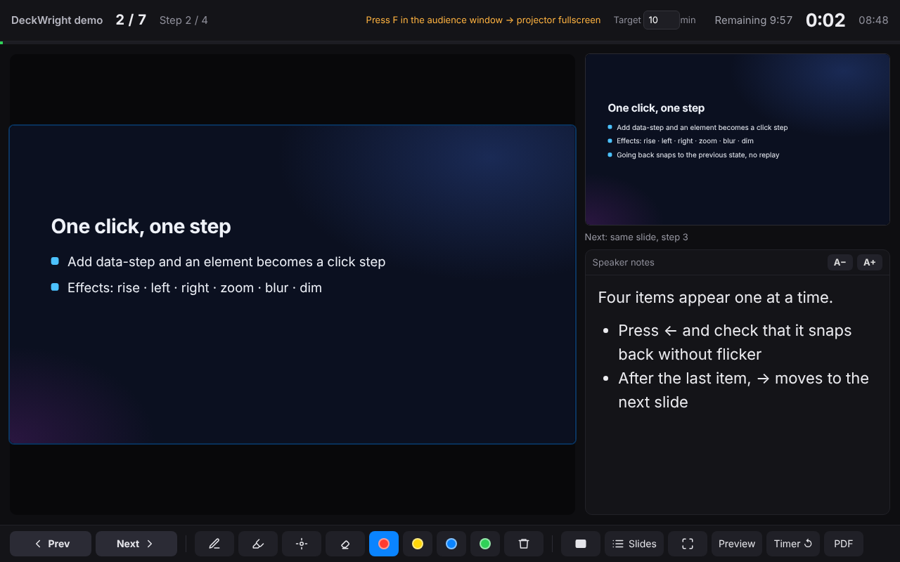

# DeckWright

English · [한국어](README.ko.md)

**Present AI-generated HTML slide decks like PowerPoint.**

HTML slides made by AI already look better than most PowerPoint files, but presenting from a browser tab means no speaker notes, no next-slide preview, no pen, and clickers that only half work. DeckWright fills that gap with a small runtime (about 85 KB, no dependencies) that lives inside the HTML file. Nothing to install, no internet needed: double-click the file and present.



**Try it:** [demo deck](https://grotyx.github.io/deckwright/demo.html) (press `S`, then `?`) · [player](https://grotyx.github.io/deckwright/player.html) · [spec](SPEC.md)

## What it does

- Click, mouse wheel, arrow keys and presentation clickers (PageUp/PageDown, F5, the blank-screen button) move forward and back, including click steps inside a slide. Going back snaps to the previous state without replaying the animation.
- **Presenter view** on the laptop while the projector shows only slides: current slide, next slide (down to the next step), speaker notes, elapsed time, time left against a target, slide list.
- Pen, highlighter, laser and eraser. A pen tablet writes right away. Ink drawn on either screen shows on both and survives a reload.
- Black / white screen, fullscreen on the second monitor when the browser allows it.
- `Ctrl/⌘+P` prints one page per slide with every step revealed.
- Works on decks that never heard of DeckWright. Decks with their own navigation engine are steered through that engine (their animations are kept); stacked fixed-size slides built for print are scaled to fit; reveal.js decks are recognized.
- UI in English or Korean, following the browser language.

## Two file forms

**Single HTML**: one `.html` file with the runtime and every image, font and video inside. Email it, put it on a USB stick, double-click it.

**`.hdek` package**: a ZIP container (`manifest.json` + `index.html` + assets) for decks with large videos or many files. Open it with `player.html`, or rename it to `.zip`, extract, and double-click `index.html`.

## Install

DeckWright ships as an Agent Skill (folder `skills/deckwright/`) with a Node CLI inside. Pick whichever fits how you work.

### Claude Code (plugin marketplace)

```bash
claude plugin marketplace add grotyx/deckwright
claude plugin install deckwright@deckwright
```

Or inside Claude Code: `/plugin marketplace add grotyx/deckwright`, then `/plugin install deckwright@deckwright`. Update later with `claude plugin marketplace update deckwright && claude plugin update deckwright@deckwright`.

### Any agent that reads skills (Claude Code, Codex, Cursor, …) via `npx skills`

```bash
npx skills add grotyx/deckwright          # project-level
npx skills add grotyx/deckwright -g       # user-level
```

### Manual copy

```bash
git clone https://github.com/grotyx/deckwright
cp -r deckwright/skills/deckwright ~/.claude/skills/
```

### claude.ai (web / desktop app)

Download [deckwright-skill.zip](https://grotyx.github.io/deckwright/deckwright-skill.zip), then upload it in **Settings → Capabilities → Skills**. Code execution must be enabled.

### Just the player (no AI, no install)

Download [player.html](https://grotyx.github.io/deckwright/player.html) (or use it online), open it in Chrome / Edge / Firefox / Safari, and drop a `.hdek`, an `.html` file, or a deck folder onto it.

### CLI only (Node.js 18+)

```bash
npm install -g github:grotyx/deckwright
deckwright --help
```

## Use

### With an AI assistant

Once the skill is installed, just ask:

- "Make this HTML deck presentable" → adds the runtime to a copy next to your file (`talk_DeckWright.html`). The original is not touched.
- "Build a 15-minute conference talk on X as a DeckWright deck" → writes a deck that follows the contract, checks it, and builds one self-contained HTML.
- "Package it as .hdek" / "Export a PDF and PPTX backup".

For an assistant without skill support, give it [`skills/deckwright/SKILL.md`](skills/deckwright/SKILL.md) as instructions.

### Presenting

Open the file. Press `S` for the presenter view, move the audience window to the projector and press `F` there for fullscreen. `?` lists every shortcut.

| Action | Keys |
|---|---|
| Next / previous | `→` `Space` `PageDown` click wheel / `←` `PageUp` |
| Jump to slide n | type `n`, then `Enter` |
| Presenter view | `S` |
| Fullscreen | `F` (or a clicker's `F5`) |
| Black / white screen | `B` / `W` |
| Pen / highlighter / laser / eraser | `D` / `H` / `L` / `E`, `C` clears |
| Print to PDF | `Ctrl/⌘+P` |

### CLI

```bash
deckwright check  my-talk/                     # contract, external CDNs, fonts, notes
deckwright inject my-talk/index.html           # index_DeckWright.html next to the original (lightest; assets stay in place)
deckwright build  my-talk/ -o my-talk.html     # one self-contained HTML
deckwright pack   my-talk/ -o my-talk.hdek     # package
deckwright unpack my-talk.hdek -o my-talk/
deckwright export my-talk/ --pdf a.pdf --pptx a.pptx --png shots/
```

Without a global install, run `node skills/deckwright/scripts/deckwright.mjs …` from the repository (or from wherever the skill was installed). `export` needs Playwright and pptxgenjs (`npm i -g playwright pptxgenjs && npx playwright install chromium`); it is a backup for conferences that only accept PPTX or PDF, with each slide's final state as an image and speaker notes copied into the PPTX notes.

## The contract in one screen

```html
<main data-hdek data-width="1920" data-height="1080" data-duration="7">
  <section data-slide="results">
    <h2>Results</h2>
    <p data-step data-effect="rise">Appears on click</p>
    <aside class="notes">Speaker notes</aside>
  </section>
</main>
<script src="deckwright-runtime.js" data-hdek-runtime></script>
```

Everything else (step effects, JS hooks for counters and charts, events, the `.hdek` format, how decks without the contract are detected) is in [SPEC.md](SPEC.md).

## Repository layout

```
skills/deckwright/              the skill (what gets installed)
  SKILL.md                      instructions for the AI
  runtime/deckwright-runtime.js runtime embedded in every deck
  core/deckwright-core.js       asset inlining, ZIP, lint (browser + Node)
  scripts/deckwright.mjs        CLI
  assets/template.html          new-deck template
  player.html                   built player
  reference/SPEC.md             copy of the spec
player/player.src.html          player source
docs/                           GitHub Pages: demo, player, skill zip
examples/                       demo deck (contract) and an AI-style deck (no contract)
test/                           Playwright tests + fixtures
.claude-plugin/                 Claude Code plugin + marketplace manifests
```

`npm run build` rebuilds the player, demo and skill zip; `npm test` runs 61 checks in Chromium (needs `pip install playwright pdfplumber python-pptx`). Navigation, presenter view and player have also been checked in Firefox and WebKit.

## Known limits

- Auto-placing the fullscreen window on a second monitor (`F`) uses the Window Management API in Chrome/Edge, which asks for permission the first time. Not yet tried on a real dual-monitor setup; if it fails, drag the audience window over and press `F`.
- The presenter previews load the deck twice more, so very heavy decks can slow down. The "Preview" button turns off the live current-slide preview.
- Video playback position is not synced between the audience window and the previews (preview video is muted).
- Animations a deck drives with its own `setTimeout` cannot be finished instantly when going back. Use the contract's `setStep` hook.
- In heuristic mode, a deck's own decorations (such as its progress bar) may not update.
- Many conferences only accept PPTX/PDF and play them from a central PC. Where you cannot plug in your own laptop, use the `export` backup.

## Roadmap ideas

- Desktop app (Tauri): `.hdek` file association, automatic dual-monitor layout, clicker key mapping
- Phone remote over local Wi-Fi (QR code)
- PDF export with ink, PPTX with video
- Signed `.hdek` and integrity checks

## License

[MIT](LICENSE) © 2026 Sang-Min Park. Ideas from Lectern and DeckStage (MIT) informed the design; the code is new.

Part of the *Wright* tools: RefWright, ManuWright, RadWright, DeckWright.
