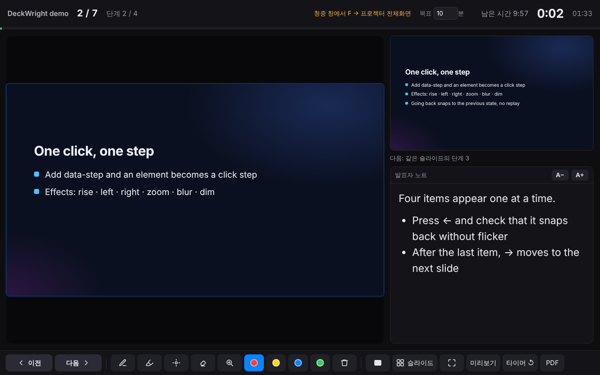
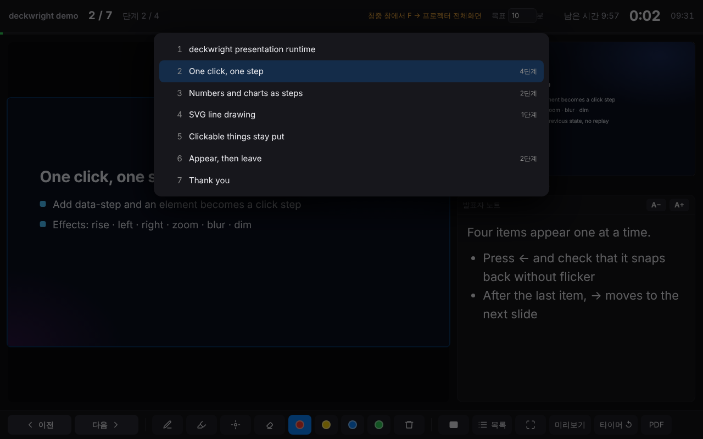
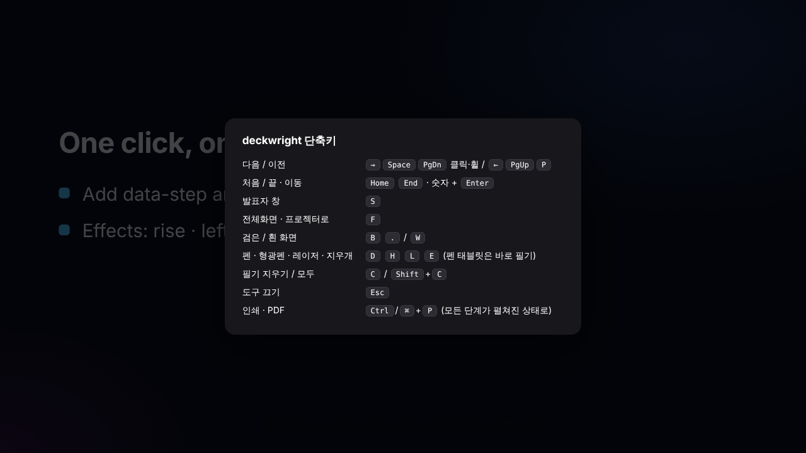
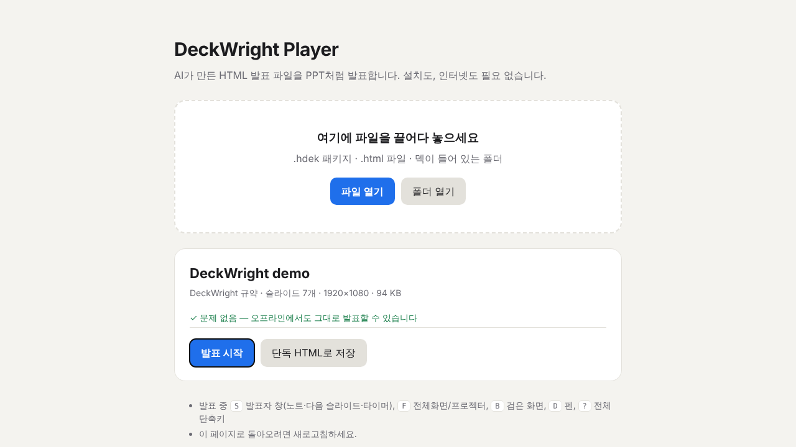

# DeckWright 사용 설명서

[English](manual.md) · 한국어 · v0.3.3

발표 하나를 처음부터 끝까지 따라간다. 설치하고, HTML 덱을 발표할 수 있게 만들고, 두 화면으로 발표하고, 슬라이드에 필기하고, 학회가 요구하는 파일을 만드는 순서다.

1. [설치](#1-설치)
2. [이미 있는 덱을 발표할 수 있게](#2-이미-있는-덱을-발표할-수-있게)
3. [AI로 새 덱 만들기](#3-ai로-새-덱-만들기)
4. [발표하기](#4-발표하기)
5. [슬라이드에 필기하기](#5-슬라이드에-필기하기)
6. [학회 제출용 파일](#6-학회-제출용-파일)
7. [플레이어와 .hdek 패키지](#7-플레이어와-hdek-패키지)
8. [문제가 생겼을 때](#8-문제가-생겼을-때)

## 1. 설치

하나만 고르면 된다. 어느 방법이든 같은 스킬 폴더(`skills/deckwright/`)가 설치되고, 그 안에 명령줄 도구가 들어 있다.

| 쓰는 도구 | 설치 |
|---|---|
| Claude Code | `claude plugin marketplace add grotyx/deckwright` 다음 `claude plugin install deckwright@deckwright` |
| Codex, Cursor, opencode 등 스킬을 읽는 에이전트 | `npx skills add grotyx/deckwright -g` |
| claude.ai (웹, 데스크톱 앱) | [deckwright-skill.zip](https://grotyx.github.io/deckwright/deckwright-skill.zip) 을 받아 설정 → 기능 → 스킬 → 업로드. 코드 실행이 켜져 있어야 한다 |
| AI 없이 | [player.html](https://grotyx.github.io/deckwright/player.html) 을 열거나, 명령줄 도구는 `npm install -g github:grotyx/deckwright` |

명령줄 도구는 Node.js 18 이상이 필요하다. 발표에는 브라우저만 있으면 된다.

## 2. 이미 있는 덱을 발표할 수 있게

AI가 만든 덱이 이미 있다고 하자. 예를 들어 `talk.html` 과 그 옆의 `img/` 폴더.

**채팅에서.** "이 HTML 덱 발표할 수 있게 해 줘" 라고 하고 파일을 알려 준다.

**명령줄에서.**

```sh
deckwright check  talk.html     # 인식 결과: 슬라이드, 단계, 노트, 외부 파일
deckwright inject talk.html     # talk.html 옆에 talk_DeckWright.html 생성
```

`inject` 는 덱을 복사하고 런타임을 넣는다. 그림과 영상은 원래 폴더에서 읽으므로 새 파일을 원본 옆에 두면 된다. `talk.html` 자체는 바뀌지 않는다.

덱을 다시 만들 필요는 없다. DeckWright는 이런 덱을 알아본다.

| 내 덱이 | DeckWright는 |
|---|---|
| 자체 방향키 이동 기능이 있다 (AI가 만든 "무대 + 장면" 덱 대부분) | 키 입력으로 그 엔진을 조종한다. 덱이 만든 애니메이션과 단계가 그대로 돈다 |
| 고정 크기 슬라이드를 세로로 쌓아 두었다 (인쇄용, PPT 변환용) | 한 번에 한 장씩, 화면에 꽉 차게 보여 준다 |
| reveal.js 를 쓴다 | reveal 의 이동은 그대로 두고 발표자 창, 필기, 블랙아웃을 붙인다 |
| 그 밖에 `section`·`.slide` 가 반복된다 | 그것을 슬라이드로, 처음에 숨겨진 `.fragment`·`.step` 을 단계로 본다 |

노트는 슬라이드 안이나 바로 뒤의 `.notes`, `aside.notes`, `.speaker-notes` 에서 읽는다. 노트가 없으면 AI에게 슬라이드마다 `<aside class="notes">` 를 넣어 달라고 하면 된다.

## 3. AI로 새 덱 만들기

필요한 것을 말하면 된다. 예: "내시경 감압술 결과로 15분 학회 발표를 DeckWright 덱으로 만들어 줘. 12장, 슬라이드마다 노트."

스킬이 DeckWright 규약에 맞춰 덱을 쓰고, 점검하고, 파일 하나로 빌드한다. 규약은 짧다.

```html
<main data-hdek data-width="1920" data-height="1080" data-duration="15" data-title="발표 제목">
  <section data-slide="results">
    <h2>결과</h2>
    <p data-step data-effect="rise">첫 번째 클릭에 나타남</p>
    <p data-step data-effect="rise">두 번째 클릭에 나타남</p>
    <aside class="notes">이 슬라이드에서 할 말.</aside>
  </section>
</main>
```

`data-duration` 은 목표 발표 시간(분)이고 발표자 창이 이 시간을 기준으로 남은 시간을 센다. 단계 효과는 `rise`, `drop`, `left`, `right`, `zoom`, `blur`, `dim`, `none`. 숫자 카운터, 차트, 캔버스 그림도 작은 JavaScript 훅으로 단계에 넣을 수 있다. [SPEC.ko.md](../SPEC.ko.md#js로-그리는-단계) 참고.

## 4. 발표하기

Chrome, Edge, Firefox, Safari 중 하나로 파일을 연다.

1. 프로젝터를 *확장* 모드로 연결한다(Windows: `Win+P` → 확장, Mac: 미러링 끄기).
2. `S` 를 누른다. Chrome·Edge 에서는 그 한 번으로 슬라이드는 프로젝터에 전체화면으로, 발표자 창은 노트북 화면에 가득 열린다. 처음에는 "창 관리" 권한을 묻는데, 허용한 뒤 슬라이드 창에서 `F` 를 한 번 누르면 되고, 다음부터는 `S` 하나로 끝난다.
   Firefox·Safari 에서는 `S` 가 발표자 창만 연다. 슬라이드 창을 프로젝터로 끌어다 놓고 거기서 `F` 를 누른다.
3. 노트북에서 발표한다. 방향키, 클리커, 클릭, 휠 모두 어느 창에서든 된다. 발표자 창에서는 현재·다음 화면 미리보기를 클릭하면 넘어가고, 그 위에서 휠을 굴리면 앞뒤로 움직인다. 노트 영역은 클릭해도 넘어가지 않으니 스크롤하거나 글을 골라도 된다.



발표자 창에는 현재 화면, 다음 단계(또는 다음 슬라이드), 노트(*A−*·*A+* 로 글자 크기 조절), 경과 시간, `data-duration` 기준 남은 시간, 현재 시각이 나온다. *목록* 을 누르면 슬라이드 목록이 열리고, 하나를 누르면 그리로 간다. 숫자를 치고 `Enter` 를 눌러도 된다.



| 동작 | 키 |
|---|---|
| 다음 / 이전 | `→` `↓` `Space` `PageDown` `Enter`, 슬라이드 아무 데나 클릭, 휠 내리기 / `←` `↑` `PageUp` `Backspace`, 오른쪽 클릭, 휠 올리기 |
| 처음 / 끝 / *n* 번 | `Home` / `End` / *n* 입력 후 `Enter` |
| 발표자 창 | `S` |
| 전체화면 | `F` (클리커의 `F5` 도 같다) |
| 검은 / 흰 화면 | `B` 또는 `.` / `W` 또는 `,` |
| 펜, 형광펜, 레이저, 지우개 | `D`, `H`, `L`, `E` |
| 이 슬라이드 필기 지우기 / 전부 | `C` / `Shift+C` |
| 도구 끄기 | `Esc` |
| 전체 단축키 | `?` |



뒤로 가도 애니메이션이 다시 돌지 않는다. 그 단계의 모습으로 바로 바뀐다. 링크, 버튼, 손가락 모양 커서가 뜨는 요소(뒤집기 카드, 탭)를 눌러도 슬라이드는 넘어가지 않는다.

실수로 새로고침해도 같은 슬라이드, 같은 단계, 같은 필기로 돌아온다.

## 5. 슬라이드에 필기하기

`D` 펜, `H` 형광펜, `L` 사라지는 레이저, `E` 지우개. 마우스를 화면 아래쪽으로 가져가면 나타나는 도구 막대를 써도 된다. 펜 태블릿이나 스타일러스는 도구를 고르지 않아도 바로 써진다.


발표자 창에서 쓴 필기는 프로젝터에도, 프로젝터 쪽에서 쓴 필기는 발표자 창에도 보인다. 슬라이드마다 브라우저에 저장되므로 그 슬라이드로 돌아오거나 새로고침해도 남아 있다.

## 6. 학회 제출용 파일

| 학회가 원하는 것 | 만드는 방법 |
|---|---|
| 내 노트북, 내 HTML | `deckwright build talk.html`: 그림·폰트·영상을 모두 넣은 파일 하나(`talk_single.html`). USB에도 한 부 |
| PDF 유인물 | 브라우저에서 `Ctrl/⌘+P` (*PDF로 저장*), 또는 `deckwright export talk.html --pdf talk.pdf` |
| PPTX 업로드 | `deckwright export talk.html --pptx talk.pptx`: 슬라이드별 최종 화면을 그림으로, 노트는 PPTX 노트로 |
| 슬라이드 그림 | `deckwright export talk.html --png shots/` |


`export` 에는 Playwright 와 pptxgenjs 가 필요하다: `npm i -g playwright pptxgenjs && npx playwright install chromium`. PPTX·PDF 는 백업용이다. 각 슬라이드의 최종 모습이 들어가고 애니메이션은 들어가지 않는다.

웹폰트(Google Fonts 등)는 파일 안에 넣지 않으면 인터넷이 필요하다. 인터넷이 될 때 `build`, `inject`, `pack` 에 `--fetch-fonts` 를 붙여 만든다.

발표 전에 최종 파일로 `deckwright check` 를 돌려 두자. 인터넷에서 불러오는 것(웹폰트, CDN 스크립트), 없는 파일, 노트 없는 슬라이드를 알려 준다.

## 7. 플레이어와 .hdek 패키지

영상이 큰 덱은 패키지로 들고 다니는 편이 편하다.

```sh
deckwright pack talk/ -o talk.hdek
```

`.hdek` 은 매니페스트, 덱, 자원을 담은 ZIP 파일이다. 플레이어로 연다. [player.html](https://grotyx.github.io/deckwright/player.html) 에 끌어다 놓고(한 번 받아 두면 오프라인에서도 된다) *발표 시작* 을 누른다. 플레이어는 일반 `.html` 파일이나 덱 폴더 전체도 열고, 끌어다 놓은 덱을 단독 HTML 하나로 저장할 수도 있다.



플레이어 없이 쓰려면 `talk.hdek` 을 `talk.zip` 으로 이름을 바꿔 풀고 덱의 HTML 파일(`manifest.json` 의 `entry`)을 더블클릭한다.

## 8. 문제가 생겼을 때

**발표자 창이 열리지 않는다.** 브라우저가 팝업을 막았다. 주소창 오른쪽 아이콘에서 이 파일의 팝업을 허용하고 `S` 를 다시 누른다.

**`F` 를 눌러도 프로젝터로 옮겨지지 않는다.** 청중 창을 프로젝터 화면으로 끌어다 놓고 거기서 `F`. Chrome·Edge 에서는 "창 관리" 권한을 묻으면 허용한다.

**클리커가 안 먹힌다.** 청중 창이나 발표자 창을 한 번 클릭해 포커스를 준다. 클리커 대부분은 `PageDown`·`PageUp` 을 보내고 DeckWright는 이를 알아듣는다.

**학회장에서 글꼴이 달라 보인다.** 덱이 인터넷에서 웹폰트(Google Fonts)를 불러오는데 학회장에 인터넷이 없다. 파일을 만들 때 `--fetch-fonts` 를 붙인다: `deckwright inject talk.html --fetch-fonts` 또는 `deckwright build talk/ --fetch-fonts`. 인터넷이 되는 노트북에서 한 번 내려받아 파일 안에 넣고, 덱에 나오는 글자에 필요한 조각만 남긴다. 채팅에서는 "폰트도 파일 안에 넣어 줘" 라고 하면 된다.

**두 장씩 넘어가거나 단계를 건너뛴다.** DeckWright가 알아보지 못한 키 처리 코드가 덱에 있다. 덱(또는 줄인 사본)과 함께 <https://github.com/grotyx/deckwright/issues> 에 알려 주면 고친다.

**`build` 가 "덱 폴더 밖이라 넣지 않음" 이라고 한다.** 덱이 자기 폴더 위쪽의 파일(`../images/x.png`)을 가리킨다. 공유할 파일에 개인 파일이 딸려 들어가지 않도록 DeckWright는 덱 폴더 밖을 읽지 않는다. 파일을 덱 폴더 안으로 옮기거나, 공통 상위 폴더를 `--root` 로 알려 준다: `deckwright build talk/ --root .`

**미리보기 때문에 노트북이 느리다.** 발표자 창의 *미리보기* 버튼으로 현재 화면 실시간 미리보기를 끈다.
