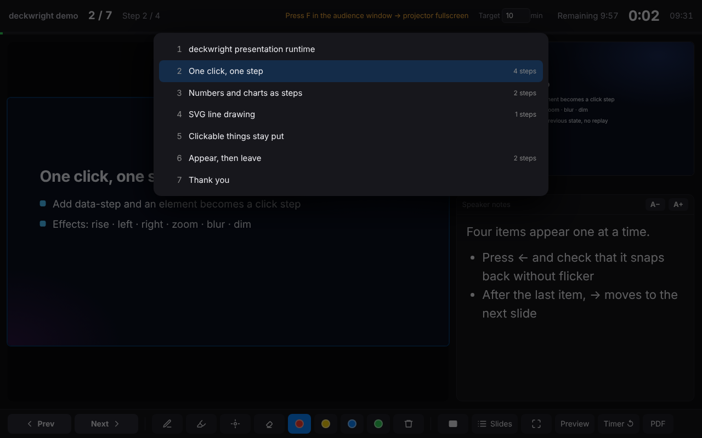
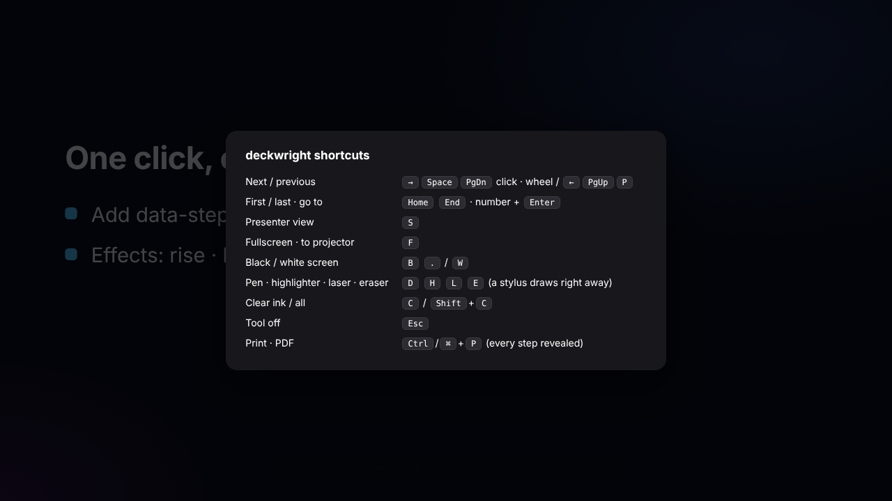

# deckwright user guide

English · [한국어](manual.ko.md) · v0.1.1

This guide walks through a talk from start to finish: installing, turning an HTML deck into one you can present, presenting with a second screen, writing on slides, and making the files a conference asks for.

1. [Install](#1-install)
2. [Make an existing deck presentable](#2-make-an-existing-deck-presentable)
3. [Make a new deck with your AI](#3-make-a-new-deck-with-your-ai)
4. [Present](#4-present)
5. [Write on slides](#5-write-on-slides)
6. [Files for the conference](#6-files-for-the-conference)
7. [The player and .hdek packages](#7-the-player-and-hdek-packages)
8. [Troubleshooting](#8-troubleshooting)

## 1. Install

Pick one. All of them install the same skill folder (`skills/deckwright/`), which carries its own command-line tool.

| You use | Install |
|---|---|
| Claude Code | `claude plugin marketplace add grotyx/deckwright` then `claude plugin install deckwright@deckwright` |
| Codex, Cursor, opencode or another agent that reads skills | `npx skills add grotyx/deckwright -g` |
| claude.ai (web or desktop) | Download [deckwright-skill.zip](https://grotyx.github.io/deckwright/deckwright-skill.zip), then Settings → Capabilities → Skills → Upload. Code execution must be on |
| No AI | Open [player.html](https://grotyx.github.io/deckwright/player.html), or `npm install -g github:grotyx/deckwright` for the command line |

The command-line tool needs Node.js 18 or later. Presenting needs only a browser.

## 2. Make an existing deck presentable

You already have a deck an AI made, for example `talk.html` with an `img/` folder beside it.

**From the chat.** Say "make this HTML deck presentable" and point at the file.

**From the command line.**

```sh
deckwright check  talk.html     # what it detects: slides, steps, notes, external files
deckwright inject talk.html     # writes talk_deckwright.html next to talk.html
```

`inject` copies the deck and adds the runtime. Images and video still load from the original folder, so keep the new file next to the old one. `talk.html` itself is never changed.

You do not need to rewrite the deck. deckwright recognizes:

| Your deck | What deckwright does |
|---|---|
| Has its own arrow-key navigation (most AI "stage + scenes" decks) | Steers that engine with key presses, so the deck's own animations and steps play as designed |
| Stacks fixed-size slides down the page (decks made for printing or PPT conversion) | Shows one slide at a time, scaled to fill the screen |
| Uses reveal.js | Keeps reveal's navigation and adds the presenter view, ink and blackout |
| Anything else with repeated `section` / `.slide` elements | Treats them as slides and initially hidden `.fragment` / `.step` elements as steps |

Notes come from `.notes`, `aside.notes` or `.speaker-notes` inside or right after a slide. If your deck has none, ask the AI to add an `<aside class="notes">` to every slide.

## 3. Make a new deck with your AI

Say what you need, for example: "Make a 15-minute conference talk on endoscopic decompression outcomes as a deckwright deck, 12 slides, notes on every slide."

The skill writes the deck to the deckwright contract, checks it and builds one file. The contract is short:

```html
<main data-hdek data-width="1920" data-height="1080" data-duration="15" data-title="My talk">
  <section data-slide="results">
    <h2>Results</h2>
    <p data-step data-effect="rise">Appears on the first click</p>
    <p data-step data-effect="rise">Appears on the second click</p>
    <aside class="notes">What I will say on this slide.</aside>
  </section>
</main>
```

`data-duration` is the target length in minutes; the presenter view counts down against it. Step effects are `rise`, `drop`, `left`, `right`, `zoom`, `blur`, `dim` and `none`. Counters, charts and canvas drawings can take part in steps through a small JavaScript hook; see [SPEC.md](../SPEC.md#steps-drawn-in-js).

## 4. Present

Open the file in Chrome, Edge, Firefox or Safari.

1. Press `S`. The presenter view opens in a new window.
2. Drag the audience window (the one with the slide) to the projector and press `F` there. In Chrome and Edge `F` can move it to the second screen by itself after asking permission once.
3. Present from the laptop. Arrow keys, a clicker, a click or the wheel all work, in either window.


The presenter view shows the current slide, the next step (or the next slide), your notes with *A−* / *A+* to resize them, elapsed time, time remaining against `data-duration`, and the clock. *Slides* opens the slide list; click one to jump there. Typing a number and `Enter` jumps too.



| Action | Keys |
|---|---|
| Next / previous | `→` `↓` `Space` `PageDown` `Enter`, click, wheel down / `←` `↑` `PageUp` `Backspace`, wheel up |
| First / last / slide *n* | `Home` / `End` / *n* then `Enter` |
| Presenter view | `S` |
| Fullscreen | `F` (a clicker's `F5` does the same) |
| Black / white screen | `B` or `.` / `W` or `,` |
| Pen, highlighter, laser, eraser | `D`, `H`, `L`, `E` |
| Clear ink on this slide / everywhere | `C` / `Shift+C` |
| Tool off | `Esc` |
| All shortcuts | `?` |



Going back never replays an animation: the slide snaps to how it looked at that step. Clicking a link, a button or anything with a pointer cursor (a flip card, a tab) does not advance the slide.

If you reload by accident, the deck comes back on the same slide and step, with your ink.

## 5. Write on slides

Press `D` for the pen, `H` for the highlighter, `L` for a laser pointer that fades, `E` for the eraser, or use the toolbar that appears when the mouse is near the bottom of the screen. A pen tablet or stylus writes without picking a tool.


Ink drawn in the presenter view appears on the projector and the other way round. It is saved per slide in the browser, so it is still there when you come back to the slide or reload.

## 6. Files for the conference

| The conference wants | Make it with |
|---|---|
| Your own laptop, your HTML | `deckwright build talk.html -o talk-final.html`: one file with every image, font and video inside. Copy it to a USB stick as well |
| A PDF handout | `Ctrl/⌘+P` in the browser (choose *Save as PDF*), or `deckwright export talk.html --pdf talk.pdf` |
| A PPTX upload | `deckwright export talk.html --pptx talk.pptx`: each slide's final look as an image, with your notes in the PPTX notes |
| Slide images | `deckwright export talk.html --png shots/` |


`export` needs Playwright and pptxgenjs: `npm i -g playwright pptxgenjs && npx playwright install chromium`. PPTX and PDF exports are backups: they hold the final look of every slide, not the animations.

Before the talk, run `deckwright check` on the final file. It warns about anything loaded from the internet (web fonts, CDN scripts), files that are missing, and slides without notes.

## 7. The player and .hdek packages

A deck with large videos is easier to carry as a package:

```sh
deckwright pack talk/ -o talk.hdek
```

A `.hdek` file is a ZIP holding a manifest, the deck and its assets. Open it with the player: drop it on [player.html](https://grotyx.github.io/deckwright/player.html) (it works offline once downloaded) and press *Start presenting*. The player also opens a plain `.html` file or a whole deck folder, and can save what you dropped as one self-contained HTML.


Without the player, rename `talk.hdek` to `talk.zip`, extract it and double-click `index.html`.

## 8. Troubleshooting

**The presenter window does not open.** The browser blocked the pop-up. Allow pop-ups for the file (the icon at the right of the address bar) and press `S` again.

**`F` does not move the window to the projector.** Drag the audience window onto the projector screen and press `F` there. In Chrome and Edge, allow "window management" when asked.

**The clicker does nothing.** Click once on the audience or presenter window so it has focus. Most clickers send `PageDown` / `PageUp`, which deckwright understands.

**The fonts look different at the venue.** The deck loads web fonts from the internet. Run `deckwright check`; then ask your AI to download the fonts into a `fonts/` folder and rebuild.

**Slides advance twice, or a step is skipped.** The deck has its own key handler that deckwright did not recognize. Open an issue with the deck (or a trimmed copy) at <https://github.com/grotyx/deckwright/issues>.

**The previews make the laptop slow.** Press *Preview* in the presenter view to turn off the live current-slide preview.
